<!-- =========================================================================
     ANIMATED GITHUB PROFILE — AYOUB ATIDI BELBAZ (@Ayoxb1)
     Monochrome ASCII Portrait + Neofetch Card + Live Contribution Graph
     Refreshed daily via GitHub Actions (.github/workflows/update-profile-art.yml)
     ========================================================================= -->

<h3><code>ayoxb1@github ~ $ ./contributions.sh</code></h3>

 
 

<h3><code>ayoxb1@github ~ $ whoami</code></h3>

<ul align="left">
  <li>💻 <b>Ingeniería de Software:</b> Estudiante de último año de DAM combinando fundamentos sólidos (Java, Concurrencia, SQL/XML) con tecnologías web modernas (Next.js, Supabase, Tailwind).</li>
  <li>⚙️ <b>Automatización e IA:</b> Creando agentes y flujos inteligentes con n8n e integración de LLMs para resolver problemas reales.</li>
  <li>📈 <b>Crecimiento constante:</b> Prototipado rápido, código limpio e iteración diaria.</li>
</ul>
<table>
  <tr>
    <td valign="top"></td>
    <td valign="top"></td>
  </tr>
</table>

 
 

<h3><code>ayoxb1@github ~ $ ./links.sh</code></h3>

<b>Full Stack Developer · Software Engineer · High-Performance Web & 3D Interactive UI</b>

 

